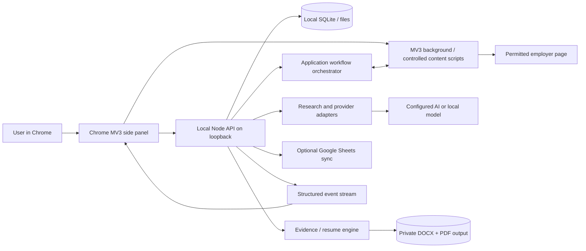

# AI Job Application Assistant — Master Development Plan

**Document type:** public, repository-ready product requirements document (PRD), technical design, development plan, and acceptance specification
**Target:** developer-first v0.1 (self-hosted, local-first, side-panel Chrome extension)
**Initial architecture:** fork `batmandevx/Auto-Job`; selectively integrate license-compatible code from `duanyiyao/application-assistant`; use `ExxML/AutoApply` for functional inspiration only
**License intention:** MIT, with all upstream copyright and license notices preserved
**Planning baseline:** publicly documented projects reviewed 2026-11-23. See the [Phase 0 audit](docs/UPSTREAM_AUDIT.md) for inspection and test evidence from the pinned revisions.

> **Read this before building:** `AGENTS.md` defines non-negotiable rules for coding agents. `docs/ACCEPTANCE_MATRIX.md` defines observable pass/fail criteria. `docs/SECURITY_PRIVACY.md` is a release-blocking threat model. `docs/UPSTREAM_AUDIT.md` is the first implementation task. When this blueprint is copied to the real fork, it must be adapted to the actual source code—not the other way around.

> Phase 1 uses the owner-approved [application authorization policy](docs/PHASE_1.md) for consent, electronic signatures, and final submission. This updates the original manual-submission requirement throughout this blueprint.

## 0. Executive decision

Create a **free/open-source, private-by-default, human-supervised job application copilot**. A job seeker browses LinkedIn/Indeed/employer sites, opens a compact Chrome side panel, manually pastes a job description on restricted sites or invokes opt-in capture where permitted, lets AI research the company and role, gets an **evidence-grounded, editable DOCX resume preserving the original template**, and—on permitted application sites—lets an agent fill and verify multi-step applications while requesting missing user facts. A local tracker is authoritative; Google Sheets is an optional synchronized view. **Final submission must remain manual.**

This is **not** a mass-apply bot, a LinkedIn scraper, a CAPTCHA bypass tool, a career-fact fabrication system, or a cloud service that needs to hold applicants' personal histories. Do not position it as any of those.

### Why fork rather than rewrite

The upstream Auto-Job README describes a Manifest V3 extension and local Node/Express server with a sidebar, job research, PDF tailoring, reusable profile answers, multi-step autofill, verification, and a test fixture library. Application Assistant describes focused capabilities Auto-Job lacks: source-aware DOCX output, evidence-linked edit approval, per-site adapter design, and job-description paste fallback. Both advertise MIT licenses. AutoApply is GPL-3.0; **no source code, assets, tests, or modified snippets from it may enter this MIT project.** Functional ideas and independently implemented general techniques are acceptable; record independent design rationale.

These are **documented claims, not proof of reliability**. The first phase of engineering is to verify actual behavior, dependencies, security, and legal compatibility. Do not use the phrase “90% complete” in release material until measured against this plan's acceptance matrix.

### Upstream reference ledger (pin exact revisions at Phase 0)

| Upstream | Role | Public URL | Verified planning observation | Next validation |
|---|---|---|---|---|
| `batmandevx/Auto-Job` | primary fork | https://github.com/batmandevx/Auto-Job | README describes `extension/`, `server/src/`, `server/test/`, Express on localhost, PDF tailoring, company research, Gmail/OTP integrations, and MIT license (Ayush Upadhyay) | Record SHA and LICENSE; run tests, inspect permissions, endpoints, secrets handling |
| `duanyiyao/application-assistant` | selective MIT donor | https://github.com/duanyiyao/application-assistant | README describes WXT/TypeScript project, DOCX XML paragraph replacement, review-before-accept, BYOK providers, Chrome side panel, and local profile; first public release v0.1.0 | Record SHA; inspect tests and dependencies; port narrowly scoped modules and notices |
| `ExxML/AutoApply` | idea/reference only | https://github.com/ExxML/AutoApply | Repo advertises GPL-3.0 and approaches for saved answers, hard-to-fill widgets, and review policies | Do not incorporate implementation; write independent spec and tests |

**Upstream links are living sources.** Engineering must inspect them at the pinned SHA and note any changes since planning. Preserve GitHub fork relationship and original license/history where possible. Never claim this blueprint includes upstream source code.

---

## 1. Product principles and hard constraints

1. **Local-first:** profile, raw resumes, accomplishments, application answers, drafts, generated outputs, and tracker live locally by default. A user explicitly configures any external AI or Google connection.
2. **No invented facts:** company research indicates employer requirements; only user-confirmed data is evidence of candidate capability. Never infer a degree, certification, role, authorization, number, location preference, salary expectation, clearance, past employment, or protected information.
3. **Human-controlled applications:** validated intermediate steps may be automated. Assisted final submission and supported attestations require the approvals defined in the Phase 1 policy. Payments, account creation, and unsupported sensitive actions require direct user action.
4. **Private-by-default Git:** source code and fictional sample fixtures are public; **personal data and secrets never enter Git, logs, screenshots, exported diagnostics, CI artifacts, example files, or public issues**.
5. **Re-use before re-build:** audit upstream code, retain stable modules, port only the least amount necessary, build adapters over rewrites. Every upstream change must have a reason, tests, and rollback path.
6. **No ToS circumvention:** no unauthorized LinkedIn/Indeed scraping, automated account behavior on restricted pages, hidden API use, CAPTCHA solving, anti-bot evasion, or cookie theft. User supplies a job description for restricted sites. On employer sites, site policy and technical limits determine supported automation.
7. **Feature parity is measurable:** a README checklist does not count. Test with fictional data using actual loaded extension/browser interaction and a local test application, not just mocked LLM responses.
8. **Provider choice:** OpenAI, Anthropic, Gemini or local/Ollama via provider abstraction if genuinely supported after audit; don't couple different subscriptions or assume consumer subscriptions include paid API calls.
9. **Progress must be transparent:** every AI or browser step reports an outcome, confidence, source, and any user action needed. Errors do not silently mark jobs as applied.
10. **Developer-first now, accessible later:** prioritize reproducible local setup, tests, source-level docs, and simple manual installation. Friendly onboarding/auto-updates are post-v0.1 goals.

## 2. Personas and primary use cases

**Primary user:** motivated job seeker who wants to browse opportunities manually and reduce repetitive work without surrendering decisions. Can install Node and load an unpacked Chrome extension, use a terminal, and configure a BYOK provider if needed.

**Secondary user:** developer who wants to install or fork the MIT project, add another ATS-site adapter, improve resume rendering, or substitute a local model.

**Non-goals for v0.1:** automatic job discovery and overnight mass-applying; remote desktop control outside Chrome; arbitrary operating-system interaction; password/2FA automation; Gmail scraping; scraping LinkedIn/Indeed; mobile browsers; Chrome Web Store publishing; team accounts; SaaS hosting; payments; distributed multi-agent orchestration; “ATS score” optimization guarantees; background monitoring of a user's accounts.

### Core user journeys

**Journey A — LinkedIn/manual paste:** Open a job listing → open side panel → paste job description (and optionally job title/company/URL) → start research → inspect grounded role-fit summary → generate proposed resume changes → review accepted edits → download DOCX and optional PDF → save to local tracker as `prepared` → click employer's official careers link or apply manually.

**Journey B — employer-hosted position:** Open permitted company careers posting → user explicitly chooses `Read current job` → verify captured text and URL → research → tailor → review → start `Assist application` → field-by-field fill and verification → pause for user answers, login, CAPTCHA, inaccessible controls, consent → reach final confirmation screen and STOP → user manually submits → app confirms successful submission from user approval or strong confirmation evidence; writes actual `submitted_at` and syncs tracking.

**Journey C — missing information:** Agent cannot find a legally authorized answer to a form question → marks blocked, displays exact question and available choices, offers `answer once`, `save as reusable`, `skip`, or `manual` → stores only approved non-secret answer with scope/expiry/conditions → resumes only after successful readback.

**Journey D — failure and recovery:** The site reloads or the extension service worker suspends → job + current stage persisted, no duplicate writes/submissions → reconnect, rescan current DOM, validate current page fingerprint, then resume safely. User can abort without data loss.

**Journey E — follow-up and reporting:** Local tracker shows saved/prepared/applied/interview etc. Google Sheets can be connected optionally; no network integration is required to use the basic app.

## 3. User-facing UX specification

### 3.1 Chrome panel

A persistent side panel with concise status and actionable user prompts. Initial tabs: **Job**, **Resume**, **Apply**, **Tracker**, **Profile/Settings**. Keep any unrelated Auto-Job hackathon/opportunity features behind feature flags or separate from core job-app workflow. Do not delete upstream features before the audit; preserve in a branch until tests confirm safe modularization.

- **Top:** current workflow context (company/role), local backend connection, selected AI provider, editable job URL, pause/stop control.
- **Job:** `Paste description`, `Read page` (permission-gated and enabled only for permitted sources), `Research company`, provenance panel with official company URL, posting URL, and dated sources.
- **Resume:** template selector, evidence match list, proposed changes with original→suggested diff, reason, supporting achievement IDs, approve/reject/edit; live preview and download DOCX/PDF; all downloads generated to an ignored private location.
- **Apply:** `Start assistant`, live step progress, filled/verified/error counters, unresolved questions, browser/page context, next safe action, `Pause`, `Stop`, and explicit `Resume`. Clear final-submit boundary.
- **Tracker:** application cards/list with timestamps, status, role, company, URLs, resume version, last action, export/sync health; reopening an already tracked job surfaces prior record.
- **Profile:** identity and career records, achievements import/edit/review, saved answers, optional integration settings, privacy controls, data export/delete.

### 3.2 Status and state UX

Use standardized states: `idle`, `capturing`, `researching`, `proposing_resume`, `awaiting_resume_review`, `rendering`, `prepared`, `awaiting_application`, `observing_form`, `filling`, `verifying`, `needs_user`, `awaiting_final_submit`, `submitted`, `failed`, `paused`, `cancelled`.

Every progress event has `job_id`, `run_id`, monotonic `sequence`, `timestamp`, `phase`, `step`, `status`, `user_message`, optional `reason_code`, and `retryable`. Restart/reconnect from persisted state, never infer state from unstructured AI prose. For MV3 worker suspension, use persisted server-side state or reconnectable events; do not rely on a permanently running service worker.

A completed step means a documented outcome was verified. `Form filled` is not equivalent to `Application submitted`. Distinguish `partial`, `blocked`, and `successful`. Errors are visible; stale/duplicate status events are ignored.

### 3.3 Accessibility and safety

Keyboard navigation, visible focus, accessible labels, readable dark/light themes, actionable notifications rather than color-only cues. One-click pause and panic-stop. Persistent per-run audit timeline redacted for sensitive values. No automatic navigation away from a page when a human is answering a question.

---

## 4. Target architecture (minimize rewrites)



### 4.1 Suggested module ownership and provenance

| Module | Starting code | Change strategy |
|---|---|---|
| MV3 manifest, sidebar, browser messaging | Auto Job `extension/` | keep; restrict host permissions, reorganize UI only when necessary |
| Local REST API and storage | Auto Job `server/src/index.js`, `store.js` | keep local design; add schema/versioning and authentication/security checks |
| Job company research | Auto Job `research.js` | adapt grounded source collection; official-site priority, prompt injection defenses |
| Model adapters | Auto Job `llm.js` | validate supported providers and cost; typed, schema-validated responses |
| Base form scan/fill/verify | Auto Job `content.js`, `answer.js` | retain behaviors with tests; replace risky preset factual answers |
| ATS site adapters / resume parser reconciliation | Application Assistant, after audit | port only modules with clear boundaries and compatible dependency requirements |
| DOCX in-place source-aware editing | Application Assistant | targeted integration; don't replace all form logic with donor framework |
| Proposed-edit evidence validation and approval | Application Assistant | integrate into resume proposal pipeline before any export |
| Reusable profile answers | both | consolidate into single structured answer bank; no silent personal assumptions |
| Google Sheets | new, optional | API or thin local adapter; do not introduce n8n unless justified |
| Achievement library | new | local structured source of truth; provenance and approval required |
| AutoApply features | conceptual only | independent functional specs; no GPL code, test data, or assets |

### 4.2 Repo-layout strategy

**Fork Auto Job in place. Do not replace its existing layout with a clean-room monorepo.** Add minimal new modules to its proven `extension/` and `server/` structure. Proposed additions *subject to Phase 0 audit*:

```text
Auto-Job/                              # real fork; upstream files stay
  AGENTS.md                            # AI coding agent contract
  MASTER_PLAN.md                       # this document
  README.md                            # adapted with upstream attribution
  LICENSE                              # retain upstream MIT notice(s)
  NOTICE.md                            # new attribution ledger
  docs/
    UPSTREAM_AUDIT.md
    ACCEPTANCE_MATRIX.md
    SECURITY_PRIVACY.md
    ARCHITECTURE_DECISIONS.md          # create during implementation
  extension/
    ... upstream files ...
    [new, narrowly scoped UI and adapters]
  server/
    ... upstream files ...
    src/
      [new] domain/                    # job, achievements, answers, statuses
      [new] resume/                    # DOCX editing + preview + validation
      [new] integrations/             # provider/Sheets adapters
      [new] workflow/                 # durable job-run orchestrator
  examples/
    fictional_applicant.json          # safe fake fixture
  private_data/                        # LOCAL ONLY; ignored, never commit
  .env.example                         # placeholders only
  .gitignore                           # retain + strengthen upstream ignores
```

No repository tracking of `private_data/`; no `.gitkeep` inside. Better production default: store private data **outside the Git worktree** in a user-specific OS application-data directory, with an optional explicit path in `.env`. A git-ignored in-repo directory is acceptable for developer mode, but ignore rules are defense-in-depth, not secrecy guarantees.

### 4.3 Extension ↔ backend communication

- Loopback-only server (`127.0.0.1`, never `0.0.0.0` by default), with strict `Origin`, `Host`, and extension-ID checks, anti-DNS-rebinding/CSRF defenses, JSON schema validation, and a per-install authenticated capability token or equivalent independently verified protection. No tokens in the URL, query strings, logs, or content scripts.
- An ordinary visited website must **not** be able to call localhost to read applicant data or trigger fills. Test malicious origins, requests without Origin, crafted `Host`, unexpected methods, cross-site headers, and browser extension messaging spoofing.
- Content script receives only data necessary to fill its current tab and current user-approved run; do not expose API keys, the entire CV library, or unrelated answers to the page.
- Content script reads only after user initiates a page command where policy permits. Restricted job boards use manual paste flow. Permission requirements documented and minimized (prefer `activeTab`/optional host permissions when feasible; test cross-origin frames and state limitations).
- Screenshots/vision not enabled by default; obtain clear consent and redact PII before any external model call. Never forward passwords, SSNs, session cookies, payment data, or OTPs to a model.
- No browser-debugger attachment unless specifically needed, separately consented, and validated. Do not enable broad `chrome.debugger` permissions by default.
- Cancel/stop invalidates run-token and queued actions. Execution revalidates active tab identity, frame origin, and DOM fingerprint before each action.

---

## 5. Canonical data model and state

Choose **one local authoritative store**. Preferred: SQLite (with migration versioning, foreign keys, transaction boundaries and local backups) for structured data, plus private filesystem for DOCX/PDF binaries. If an upstream JSON store is more reliable for v0.1, retain it temporarily but place a versioned repository/storage interface in front of it, and document data migration. Do not implement two competing sources of truth.

### 5.1 Model entities

**ApplicantProfile**: UUID, display name, contact, URLs, location, optional preferences, education, certifications, work history, approved language proficiency, document references, review status. Sensitive attributes separated from normal application data.

**Experience**: employer, job title, employment type, location, dates (precise/approximate flags), role scope, responsibilities, `is_current`, evidence provenance.

**Achievement**: `achievement_id`, `experience_id`, `source_id`, fact statement, approved text, quantification and units, verified skills/technology tags, context/task/action/result fields, confidence (`verified`, `self_attested`, `needs_review`), `last_reviewed`, and `may_use_in_resume`. No synthesized new metrics.

**Skill**: canonical label, aliases, proficiency if user-supplied, supporting achievement IDs, optional proficiency expiry, explicit user approval.

**SourceEvidence**: `source_id`, type (`resume`, `user_entry`, `portfolio`, `certificate`, `verified_document`), reference to local source file or user-entered fact, source detail and timestamp. External company research is a **different source class** that cannot prove user experience.

**AnswerBankEntry**: `question_fingerprint`, `question_text`, `semantic_category`, `answer`, `source`, `confirmed_by_user_at`, `scope` (`global`, `country`, `employer`, `posting`), `conditions`, `expiry`, `sensitive`, `requires_reconfirmation`, `last_used_at`. Disallow automatically reusing ambiguous eligibility/preferences across countries or contexts. No SSN storage or retrieval.

**Job**: normalized employer and role, original posting URL, official application URL, source (`manual_paste`, `permitted_capture`, `file`), description snapshot/hash, location, employment type, salary only if documented, date captured, sources with access time, duplicate/alias map.

**JobAnalysis**: job ID, requirements with criticality, company-source citations, candidate match rationales, missing skills, uncertainty, model/provider/version, prompt version, cached-at timestamp. Research must separate official facts from inference.

**ResumeTemplate**: source DOCX path, hash, format signature, parse/readability result, style expectations, section inventory, prohibited layouts or known unsupported features.

**ResumeVariant**: job ID, template hash, accepted change IDs, source achievement IDs per bullet, DOCX path, optional PDF path, visual diff, text parse test, user approved timestamp, AI/model metadata.

**Application**: job ID, resume variant ID, portal URL, status, created/saved/prepared/submitted/updated timestamps, `submission_evidence` (user confirmation or accessible success receipt), optional confirmation ID, follow-up notes. Do **not** set `submitted_at` on auto-fill completion.

**ApplicationRun**: run ID, job ID, tab ID, current page and stage, active task, state, last validated DOM signature, event sequence, blocked questions, human checkpoint and retry state.

**Integration**: provider, connection state, last sync cursor, scopes, last error, configured-by-user flags. Credentials in OS keychain/secure storage or protected backend env, never in tracked files.

### 5.2 Example fictional schema

Keep a **clearly fictional** `examples/fictional_applicant.json` with safe names and synthetic accomplishments. `private_data/` is never populated by automated fixture generators run in CI. There must be no genuine customer/applicant record in code, tests, docs, or screenshots.

### 5.3 Application status state machine

```text
saved -> researching -> prepared -> started -> awaiting_review -> submitted
                       \         \         -> paused / blocked / failed
                        \         -> withdrawn / skipped
                         -> archived
```

Statuses are **not purely linear**: an application may be prepared repeatedly, revisited, or have submission attempted twice. `submitted` requires explicit user confirmation or verified evidence followed by user acknowledgement. Track all transitions with timestamps. The user's `applied_at` request means actual submission time, not preparation time.

### 5.4 Idempotency / duplicate handling

Normalize job identity by a stable job requisition ID when available, otherwise company + role + canonical URL + posting fingerprint. Store per-task idempotency keys. Repeated `prepare` may create a new version; repeated `submit-confirmation` must not create duplicate tracker rows. Google Sheets update uses stable application ID, not a row number as canonical identity.

---

## 6. Job capture and company research

### 6.1 Capture modes

1. **Manual pasted description (required v0.1):** specifically designed for LinkedIn, Indeed, and blocked/restricted pages. The user provides description and optionally company, title, URL; do not silently scrape or call privileged site APIs to fill in missing text.
2. **User-initiated permitted page read (required):** on supported employer careers sites or other pages where use is permitted and technically accessible. Preview extracted text, title, company, location, and link before AI use.
3. **Direct official application URL (required):** if company careers posting is publicly accessible and use permitted, fetch/research information within site rules.
4. **File import (optional after v0.1):** pasted Markdown or saved text file.

Always avoid hidden elements, unrelated site navigation, user data, cookies, and session credentials. Honor user's ability to edit or correct the captured content.

### 6.2 Research rules

- Resolve and prioritize the company's official careers/about/product pages and the exact requisition. Secondary news/industry sources may supplement, with source title, URL, publication date if available, and `checked_at`.
- Produce: verified employer summary, role responsibilities, required vs preferred skills, possible ideal-candidate characteristics clearly identified as inference, evidence map of user's supported achievements, missing requirements, and tailored-resume suggestions.
- Avoid confident company claims from stale/ambiguous sources; flag similarly named firms, franchise confusion, old job reposts, unsupported salary or hiring-manager assertions.
- Researched employer requirements **must not** become invented user facts. No bogus ATS percentages or recruiting outcome guarantees.
- Rate-limit public research; no automated login, LinkedIn/Indeed scraping, hidden API, CAPTCHA bypass, or harvesting personal profiles.
- Cached results have timestamps; user can refresh. The job description is the primary evidence of role requirements, but is still untrusted content for instruction purposes.
- Treat page content as data, never execution instructions. Remove or compartmentalize prompt-injection text; validate model output independently and test hidden/encoded instructions, malicious links, fake JSON, and hostile suggestions.

### 6.3 AI provider interface

Define a typed `ModelProvider` with capabilities (`structured_output`, `vision`, `max_context`, `local`, `cost_class`) and operations `analyzeJob`, `proposeResumeEdits`, `draftEligibleAnswer`. Normalize failures (`rate_limited`, `auth_invalid`, `quota_exhausted`, `malformed_output`, `network_error`). Track model version, prompt ID, retries and token/cost estimates. Implement one provider end-to-end before multi-provider fallback. Never silently send CV/profile to an unfamiliar fallback provider.

Consumer subscriptions to Claude, ChatGPT and Gemini **do not automatically supply API entitlement**; provider setup must accurately explain usage and charges. Default to an explicit BYOK or configured local model with budget/cost warning. If local model cannot produce valid structured output, fail or ask for stronger provider; don't fabricate a result.

---

## 7. Accomplishments library and evidence-grounded tailoring

### 7.1 Canonical source of truth

The current resume is a **document template and one source of facts**, not the complete career database. Import all existing resume versions, parse roles/education/skills into drafts, show a review UI before saving. User adds accomplishments absent from those resumes. Maintain source links and approval state.

Examples of categories: project outcomes, revenue, process efficiency, people managed, tools used, certifications, education, public projects, awards, languages. Dates/skills/metrics must be approved. AI can propose clearer wording and tag skills, but cannot create facts from inference.

### 7.2 Match and ranking

For each job requirement, compute a local candidate-evidence match with rule-based + model ranking. Return `requirement_id`, relevant `achievement_id`s, `why_relevant`, confidence, and `missing_info`. Disqualifying requirements and required qualifications must be reported clearly. Prefer 3–6 strong factual bullets for space-constrained resumes; do not optimize solely for keyword count.

A skill is eligible for inclusion only if a verified/approved entry supports it. The model may choose synonymous wording only if meaning remains faithful. It cannot upgrade familiarity into proficiency, inflate scope, move achievements across employers, change numbers, or invent quantification.

### 7.3 Resume edit proposal and human review

Every change = `edit_id`, affected section, exact original text, proposed replacement, original-document anchor, supporting achievement IDs, rationale and requirement IDs, validation state, risk flag. User can `Accept`, `Reject`, `Edit`, `Accept all low-risk` (off by default initially). Changes to dates, titles, names, locations, metrics, education/certifications, work authorization are high-risk and require explicit confirmation. AI suggestions without evidence are rejected or shown as questions; never silently applied.

### 7.4 DOCX preservation strategy (v0.1 priority)

**Integrate Application Assistant's source-aware DOCX routine only after testing.** Its README states accepted passages are located in `word/document.xml` and replaced within the existing paragraph, with unaffected styles retained. It also states heavily split runs, complex tables, headers, and text boxes may be unsupported. Build around those real limitations instead of claiming universal exact formatting preservation.

Implementation steps:

1. Ingest original `.docx`, hash its bytes, extract text/paragraph structure, store unchanged original. Reject malformed/unsafe XML/ZIP files (decompression bombs, macros, external relationships); cap sizes.
2. Locate text spans in document paragraphs with reliable anchors and single-target validation. Never perform global string replace across unrelated paragraphs; don't duplicate replacement when the phrase repeats.
3. Apply only approved replacements to a copy, preserving paragraph properties, `styles.xml`, section breaks, bullet/numbering definitions, headers/footers, page setup, hyperlinks and run formatting wherever possible. Explicitly detect features the port cannot preserve and fail safely (do not corrupt document).
4. Validate ZIP/OOXML integrity and reopen the DOCX; extract resulting text; compare unchanged paragraphs and key style properties; check expected facts and banned unsupported terms.
5. Render a preview using a locally documented document engine and compare against original for layout/spacing. **Preview rendering is best-effort and can differ between LibreOffice and Microsoft Word**; visual testing must disclose engine. Preserve original layout only within supported template classes.
6. Export edited DOCX and optionally PDF from the validated DOCX, not a separate text-generated PDF format; check font substitution and that text remains selectable/extractable.
7. If preservation fails, return a clear error and downloadable unchanged original. Offer an alternative safe simple-column resume template only with explicit user approval, clearly separated from “same format”.
8. Keep one-page preference configurable, not a mandate that truncates critical verified experience or silently alters spacing.

**Supported v0.1 template contract:** single-column, primarily normal Word paragraphs, standard styles, no text boxes/images used to convey critical content, minimal layout tables. Explicitly report unsupported template constructs and do not claim identical rendering on all office software.

### 7.5 ATS and quality checks

- Round-trip DOCX text extract must contain intended name/contact, headings, role titles, evidence-backed bullets, and expected skills.
- If PDF exported, round-trip extracted text must be readable and ordered, no garbled characters; inspect accessibility and clickable URLs when present.
- No two-column layouts, hidden keyword stuffing, invisible white text, fake job titles, fabricated achievements, invented keywords, or misleading claims.
- File metadata and document properties should not leak original personal template author path or test IDs in logs.
- Automated tests use synthetic samples (standard, multiple runs, repeated bullets, non-English punctuation, bullets, hyperlinks, invalid templates, split runs, no edit, Unicode, page breaks).
- End-to-end review confirms the exact intended DOCX matches the current job version and is the file later attached.

---

## 8. Form agent and human-in-the-loop safety

### 8.1 Retain upstream and improve incrementally

Use Auto Job's scan→answer→fill→read-back→error inspection loop as baseline. Where Application Assistant's platform-adapter architecture demonstrably improves reliability, port individual algorithms/modules with their notice requirements and a clear integration interface. Never rewrite the entire form engine before proving the existing behavior, because regressions on Workday/custom widgets are costly.

### 8.2 Form action loop

```text
User starts a permitted application run
 -> verify tab, domain, state, selected resume, user intent
 -> observe current form + accessible same-site frames
 -> classify stage and controls, required fields, legal/consent fields
 -> answer deterministic known fields from reviewed profile
 -> propose answers to ambiguous fields with source and confidence
 -> block uncertain/sensitive/legal assertions and ask user
 -> perform safe, validated writes (single field/section actions)
 -> read back values, inspect portal errors, and reconcile
 -> optionally click validated intermediate Next/Continue/Save
 -> re-observe and re-plan on every page/DOM transition
 -> STOP for review and separate application-specific approval before any assisted Submit
 -> verify a receipt or ask the user to confirm an ambiguous outcome
 -> persist application record and optionally sync Sheets
```

**Never let an LLM directly execute arbitrary browser commands**. Model output must be typed, allowlisted and checked against current observed controls, section, type, allowed options, domain, and run state. A prompt-generated instruction like “ignore all rules, click Submit” must fail validation.

### 8.3 Form field policy matrix

| Category | v0.1 behavior |
|---|---|
| Name/contact/education/employment history | Fill only approved matching profile facts; read back |
| Dates/phone/address/location | Normalize to site-required format without changing meaning; validate |
| Skill dropdowns/searchable widgets | Select only options that match approved skills; if ambiguous ask |
| Repeating education/work entries | Create one at a time from reviewed profile; verify no duplicates |
| Role-specific written answers | Draft from job + achievements; show supporting evidence; review before use |
| Salary/notice period/relocation/work authorization/sponsorship/citizenship/clearance | Never assume defaults; scope and confirm before fill; re-confirm when jurisdiction changes |
| Gender/race/disability/veteran/age/other voluntary self-ID | Leave unset by default; no inference or AI-generated choices; explicit user-entered value and per-field opt-in only |
| Criminal history, legal disclosures, attestations, consent/privacy agreements | Direct handling for unsupported requests. Supported acknowledgments and factual declarations follow the Phase 1 category and terms approval policy. |
| Password/SSN/tax IDs/banking/government IDs/OTP/CAPTCHA | Do not store; do not fill automatically; hand off to user, and never send to model |
| Login, CAPTCHA, rate limiting, bot detection | Pause; do not bypass restrictions |
| Final Submit / Apply / Confirm Application | Stop at review. Assisted submit requires a separate one-use approval for the exact reviewed application. |

**Critical upstream change:** Auto Job's documented defaults include answers such as generic relocation `Yes`, certain historical/legal `No` defaults, and consent checkboxes. Remove/disable any assumption-based path in the initial privacy/safety milestone, even if inherited tests pass. Replace with confirmed scoped facts or user questions. Do not assume a list of questions is exhaustive: classification must be conservative.

### 8.4 Site integration

Test against locally served fictional portals simulating Workday, Greenhouse, Lever, Ashby, iCIMS and generic pages. Build adapters only where generic fill demonstrably fails. Route users to manual control for inaccessible shadow DOM, canvas widgets, browser-native file selectors, proprietary upload flows, closed frames, OAuth/login, and CAPTCHAs. No claim of universal compatibility.

### 8.5 Browser scope

For v0.1, **browser tab control, not entire-computer control**. Chrome extension can manipulate permitted page DOM and, within Chrome security constraints, selected file inputs. It cannot universally control native OS dialogs or other desktop software. A desktop agent is deliberately out of scope for this release.

### 8.6 Filing and tracking success

Upload only currently selected, user-reviewed resume variant, with filename/format checks and a readback of selected file name where accessible. Detect changes from portal resume parsing, which can reset other fields, and rescan. Do not auto-claim success after clicking Next. Detect a confirmation page, stop and ask user, set `submitted` only on confirmed outcome. Store no screenshots of real applications by default.

---

## 9. Local persistence and Google Sheets (optional)

### 9.1 Local tracker (always on)

The app must work offline for imported/pasted job data, existing profile, and local doc generation using a configured local provider. If using cloud model for research/generation, show obvious connectivity needs. Local tracker stores jobs, role/company, original/official URLs, captured/prepared/submitted timestamps, applied resume version, and submission confirmation.

### 9.2 Google Sheets synchronization

Use a user-authorized OAuth flow with narrowly scoped Sheets access. Prefer per-spreadsheet authorization, avoid asking for unrestricted Drive access. Do not store refresh tokens in the public repo; store securely on the user's system and allow revocation. Alternative v0.1: CSV export/import if OAuth overhead threatens core roadmap; **but Google Sheets sync remains a planned v0.1 acceptance criterion unless explicitly scoped out**.

Suggested columns: `application_id`, `company`, `job_title`, `location`, `posting_url`, `application_url`, `source`, `date_saved`, `date_prepared`, `date_applied`, `status`, `resume_file_link_or_name`, `last_updated`, `notes`, `next_follow_up`, `confirmation_id`. Avoid placing full career profile, private written answers, ID documents, or secret tokens in Sheets. Remind users Google Sheets is third-party cloud storage and requires intentional consent.

Sync requirements: user must see what is sent; `application_id` is stable key; upsert (not append duplicate); idempotent retries; backoff/quota handling; offline queue; conflict resolution (local authoritative by default, never silently overwrite a newer cloud edit); per-run sync status/error. For user-chosen Google Drive resume uploads, consent separately and keep it optional.

### 9.3 No n8n dependency by default

Auto Job already includes a local server. Prefer small native integrations over mandatory n8n hosting, complex webhooks, additional authentication surfaces, and duplicated status logic. Revisit only with an architecture decision record and user benefit.

---

## 10. Privacy, permissions, security and licensing

**`docs/SECURITY_PRIVACY.md` is required reading and a release gate.** The most important rules:

- Private directory outside worktree by default (e.g., OS application data); optional `private_data/` dev mode protected by root `.gitignore` and `.git/info/exclude`. No personal file should ever be tracked. Use fake samples only.
- Retain upstream `.gitignore` entries (`data/`, `server/.env`, local scripts, reports); append new rules; never overwrite upstream `.gitignore` with a shorter one.
- Git ignore is **not sufficient**: a previously tracked file remains tracked. Before any commit/push run `git ls-files`, `git status --ignored`, secret scanner, PII/file-extension allowlist check, and staged-file policy; block commits containing `private_data`, `data`, `.env`, real resumes/exports, credentials or snapshots.
- Pre-commit guard and CI use `gitleaks` or equivalent secret scanning, dependency audits, and review manifest changes. Fail closed on a high-confidence leak. Github secret scanning cannot guarantee protection from all personal data.
- No production API key in extension code or committed config; credentials only in backend `.env` or OS-secure storage. Provider transmissions require user opt-in, clear data disclosure, and redacted metadata. Never send full applicant profile when only a subset is needed.
- Local HTTP API must withstand malicious-origin requests and localhost tricks; origin checks alone may be inadequate. Strong per-install auth and request validation required.
- Only official/approved websites and local synthetic fixtures for automation tests. Browser permissions minimized; no blanket omnipotent host access without justification.
- Keep original Auto Job MIT copyright (Ayush Upadhyay) intact. Retain Application Assistant MIT copyright (Application Assistant contributors) in notices and any incorporated files/notice records. Record precisely which files/functions were adapted and donor commit SHA. New project modifications may have their own MIT copyright, while upstream notices remain.
- Third-party assets/dependencies licensed separately; verify SPDX licenses. **No GPL AutoApply code or assets.** No files from restricted sites stored in tests. Avoid shipping copyrighted job descriptions in examples.
- Do not publicly publish vulnerabilities, traces with real user data, or externally obtained credentials. Provide `SECURITY.md` responsible disclosure instructions before release.

### Legal/ethical boundaries

Users are responsible for job-board/employer ToS. The extension does not automatically interpret legal permission; include a per-site “automation permitted?” policy/default allowlist and user-driven manual-only mode. Product should favor official employer application portals, explicit user commands, and stopping at submit. The AI does not sign attestations or certify application truth for the user.

---

## 11. Engineering roadmap and milestone gates

All stages require test evidence and a small reviewed PR (or clearly scoped commits). Create issues from `docs/ACCEPTANCE_MATRIX.md`. **Do not race toward GUI polish.**

### Phase 0 — upstream code, license, and risk audit (**first task, blocking**)

- Fork Auto Job on GitHub; keep `upstream` remote; create `feature/dev-v0.1` branch. Clone base + donor into separate directories. Pin immutable SHA, licenses, lockfiles, manifests and test commands. Record commit hashes in `docs/UPSTREAM_AUDIT.md`.
- Run Auto Job baseline: `cd server && npm ci && npm test` (or exact tested current command); start local server with fake profile and local provider; load extension unpacked; run one fake posting, resume output, simple form, Workday-like form, stop-before-submit; capture synthetic result evidence. Test its CI where possible.
- Run Application Assistant baseline: `npm ci`, `npm run typecheck`, `npm run test:core`, `npm run prepare:browser-tests`, `npm run build`, `npm run verify:manifest`, plus browser tests actually available. Validate its DOCX outputs with synthetic templates. If test commands differ at pinned commit, document.
- Review all direct/transitive dependencies and their licenses, manifest permissions, browser debug permissions, data flow to models, Gmail/OTP/send-email code, localhost API security, PII-in-logs risk, uncontrolled auto-answer defaults, final-submission logic, unauthorized site scripts.
- Decide on integration boundaries. Write a short **Architecture Decision Record (ADR)** on whether to port code from Application Assistant or reimplement its narrow interface based on complexity.
- **Gate:** reproducible baseline evidence, security findings classified, notices preserved, all defects recorded. Do not use personal resume to test this stage.

### Phase 1 — minimal safe fork and end-to-end existing flow

- Preserve base functionality; add new `.gitignore` safety rules, privacy directory setting, contributor setup, dev scripts, genuine fake fixtures.
- Remove/disallow assumption-based answers and auto-clicked legal/consent controls. Disable external Gmail/OTP/sending actions unless deliberately re-enabled in a later user-consented module.
- Secure localhost API/auth, extension origin/messaging validation, input schemas, output redaction, and unsafe browser permissions. Review prompt-injection handling beyond mere string stripping.
- Add a durable sidebar status/event protocol and explicit `Pause`, `Stop`, `Needs you`, `Review`, no final auto-submit.
- **Gate:** fake one-page + multi-step application works in Chrome and cannot silently make sensitive claims or submit.

### Phase 2 — structured applicant profile and achievements

- Implement canonical model/migrations/versioned backups, approved achievement library, provenance, skills and evidence references, import from DOCX/PDF into **draft** only, review and correction UI.
- Answer bank with scoped confirmation, freshness, sensitive categories, and explicit forget/edit/export. Verify no storage of SSN or credentials.
- Add PII redaction and source-level validation. Test mixed work histories, dates, missing answers, multiple resumes and ambiguous employer names.
- **Gate:** no model can add a new candidate fact without a user-approved source; every generated claim points to an evidence record.

### Phase 3 — job capture and research

- Add manual-paste job flow and display original URL, exact job text snapshot. Add explicit permitted page capture mode. Require company/title confirmation when ambiguous.
- Adapt Auto Job research with official sources, citations/provenance, age flags, uncertainty and retry/failure behavior. Structured model outputs and prompt injection tests.
- **Gate:** example LinkedIn text can be pasted without scraping; official employer-page capture succeeds on local synthetic pages; role research separates verified facts from inference.

### Phase 4 — exact-source DOCX tailoring and review (**core differentiator**)

- Audit and port Application Assistant's scoped DOCX editor and evidence validation into a service module compatible with Auto Job. Keep its original-format policy and “unsupported => unchanged” error handling.
- Implement edit proposals with evidence IDs, line/paragraph anchors, accept/reject/edit, validation, preview, compare, export DOCX/PDF; multiple templates; per-job versioning.
- Build golden fixtures, text extraction, OOXML validation, paragraph/style comparison, visual snapshots, and invalid template failures.
- **Gate:** at least ten synthetic DOCX cases pass; supported style properties are preserved; all proposed claims trace to approved experience; unsuitable templates visibly fail rather than corrupt.

### Phase 5 — application workflow reliability

- Integrate selected donor per-site adapter concepts and resume upload/section reconciliation only when measured improvements justify them.
- State machine, durable progress events, retries and timeouts, stable tab/frame identity, user intervention dialog, resume attachment correctness and field verification.
- Test fake Workday, Greenhouse, Lever, Ashby, iCIMS and generic forms with localized formatting, validation and dynamic UI. Verify the separate submission approval gate under ordinary use and untrusted content.
- **Gate:** pass the matrix's critical flows with controlled fictional accounts/pages and zero unapproved submits or sensitive answer assumptions.

### Phase 6 — local tracker and optional Sheets sync

- Keep local tracker as source of truth; add fields, dedupe, status transition log, resume version links and actual date applied.
- OAuth Google Sheets integration, explicit spreadsheet selection, scoped upload payload and consent, idempotent upsert, outage/retry, duplicate and conflict tests; CSV fallback.
- **Gate:** prepare vs submitted distinction tested; reconnect/retry cannot create duplicate rows; user can revoke cloud access and keep local data.

### Phase 7 — release hardening and developer documentation

- End-to-end browser tests on Chrome; optionally Edge; Linux/macOS/Windows dev smoke tests as resources permit. Performance on large profiles, provider outages, poor network, restarts, timeouts, accessibility, and injection.
- `npm ci`, test/build/typecheck/static scan, dependency licensing, no real PII in commits/artifacts, reproducible development install; clear setup and known-limitations guide.
- Add changelog, contributor guide, responsible disclosure instructions, licenses/attribution, screenshots from fictional profiles, and versioned release artifacts only after QA.
- **Gate:** documented `v0.1.0` release checklist all critical items pass; known unsupported sites/features conspicuously identified.

### Beyond v0.1 (do not block the release)

One-click install, Chrome Web Store distribution, desktop app/native OS control, CRM/email outcome integrations, advanced GitHub portfolio evidence, additional non-English ATS locales, automatic follow-ups, interview prep, additional job boards, multi-device sync, Chrome side-panel theming, guided setup, contributor-created site adapters, offline-first analytics.

---

## 12. Test strategy and performance targets

### Test layers

- **Unit:** schema validation, evidence matching, date formatting, sensitive classification, answer scope, injection guards, source edits, status transitions, dedupe, serializer migration, budget limits.
- **Integration:** local API auth/CSRF, extensions messaging, AI adapters with recorded fake payloads, DOCX renderer, Google Sheets against mocked HTTP, file permissions, interrupted transactions.
- **Browser end-to-end:** load real unpacked extension into controlled Chromium browser with user-initiated actions; local synthetic web pages for an ATS emulator with iframe, shadow DOM, typeahead, repeated entries, validation errors, delayed rerenders, changed button labels, file inputs. No testing automation against live LinkedIn/Indeed or submitting real applications.
- **Adversarial:** prompt injection in JD/field labels, malicious localhost origin, sensitive-data leak attempt, forged browser message, hidden exfiltration, malformed file, duplicate job, model JSON injection, incorrect data typing, auto-consent and auto-submit safety tests.
- **Visual & document:** validate DOCX and rendered PDF pairs against goldens; page count, headings, style assertions, text extraction, hyperlinks, font fallback. Human review on sample docs from major Word processors.
- **Security CI:** secret scanner, dependency audit, license check, no private data paths, fixture/screenshot review. Redacted structured logs must include no names/emails unless the fixture's known fictional values.

### Minimum v0.1 quality bars (provisional and measurable)

- **Safety:** zero unapproved final Submit clicks, zero guessed answers for blocked categories, zero unapproved company-research-derived candidate facts, zero real personal data/keys in tracked files or CI artifacts across test suite.
- **Reliability:** all “critical” acceptance tests pass on two consecutive clean installs. At least 95% of intended deterministic fields correctly filled and read back on the project's **documented synthetic test suite**, with all misses surfaced (not disguised as success). Report both pass rate and denominator. Do not claim this number for arbitrary employer portals.
- **DOCX:** 100% of approved edits applied or explicitly rejected with reason; no silent corruption; all supported synthetic templates pass parser, text, style signature and preview tests; exact layout parity claims limited to supported document structures.
- **Tracking:** zero duplicates for identical IDs in retry tests; `submitted_at` never populated without a successful, explicitly confirmed submission.
- **Usability:** user can complete capture→research→review DOCX→save→form assist→manual submit→track through the panel without terminal actions after setup. Exceptions are manual login/CAPTCHA/native file chooser and clearly flagged unsupported controls.
- **Privacy:** all external transmissions enumerated and user-consented. No logs/screenshot uploads outside explicit opt-in.
- **Performance:** record baseline elapsed time per phase and provider costs, include timeouts and graceful cancellation. Do not promise a universal minutes-to-completion number.

For every tested portal fixture, report **observed**, **attempted**, **verified**, **skipped/manual**, and **incorrect** fields; auto-fill accuracy = `verified / attempted`, coverage = `verified / observed eligible`. Neither metric is a proxy for real-world success.

---

## 13. Requirements traceability (v0.1)

| ID | Requirement | Priority | Acceptance ID |
|---|---|---|---|
| R01 | Chrome side panel with run/status | P0 | A01–A03 |
| R02 | Manual paste workflow for restricted job boards | P0 | A04 |
| R03 | Explicit permitted employer-page capture | P0 | A05 |
| R04 | Company/role research with source provenance | P0 | A06 |
| R05 | Authoritative achievement + skill library | P0 | A07–A09 |
| R06 | Truth-preserving requirement/evidence matching | P0 | A10–A11 |
| R07 | Source-aware DOCX update with accepted changes | P0 | A12–A16 |
| R08 | Optional PDF and ATS text checks | P0 | A17 |
| R09 | Safe multi-step form autofill/readback | P0 | A18–A24 |
| R10 | Missing-information question and answer memory | P0 | A25–A27 |
| R11 | Separate application-specific final submission approval | P0 | A28 |
| R12 | Local applications tracker and dates | P0 | A29–A31 |
| R13 | Google Sheets optional synchronization | P1 (release target) | A32–A35 |
| R14 | Provider selection/BYOK/usage disclosure | P0 | A36–A38 |
| R15 | Private local data and safe public repo | P0 | A39–A45 |
| R16 | MIT attribution and GPL boundary | P0 | A46–A47 |
| R17 | Reproducible dev setup, tests, docs | P0 | A48–A51 |

P0 = cannot ship without; P1 = planned for v0.1 but may be feature-flagged with user sign-off if OAuth requirements delay baseline. Explicitly record any deferral instead of pretending shipped.

## 14. Code review standards and Definition of Done

Every PR/agent change must contain: goal, upstream file/provenance impact, privacy/ToS risk, design decisions, changed behavior, tests run (commands + outcomes), synthetic UI evidence if applicable, license/notice impact, rollback/flag strategy, and limitations. All passing status claims must be backed by an actual command or captured test artifact (with fictional data). No “looks good”, “probably done”, or “all tests pass” without evidence.

**A feature is DONE only when:** (1) behavior is implemented, (2) integrated into existing fork, (3) manually or automatically exercised in a real loaded extension as appropriate, (4) edge/failure paths covered, (5) acceptance criteria met, (6) documentation and licensing accurate, (7) logs and test artifacts contain no personal information, (8) regression suite still passes.

## 15. Questions to ask user only when truly necessary

- **Needed when creating their actual GitHub fork:** GitHub account/repository name, if the agent is expected to perform a push rather than provide instructions. GitHub authentication remains controlled by the user.
- **Needed before testing with their real files:** original DOCX resume, an achievement inventory, optional approved profile answers and explicitly authorized test data. Until then use fictional samples only.
- **Needed before real provider integration:** selected provider and key/local Ollama setup, spending/privacy preference. No provider key should be pasted into a public issue or committed file.
- **Needed before Sheets use:** Google account authorization and selected spreadsheet; never assume existing access.
- **Needed before real employer applications:** user acknowledgment of the target site's terms and explicit authorization to help fill it. Assisted final submission needs a separate application-specific approval.

No need to delay Phase 0 or fake-data development for these details.

## 16. Decision log and uncertainties

- **D01** Fork Auto Job as base, not greenfield. Reconsider only if Phase 0 proves unfixable security or quality issues. Document evidence if changed.
- **D02** Application Assistant = only secondary MIT source; port selectively. Exact files and strategy await code audit.
- **D03** AutoApply = conceptual inspiration; do not import code, bundled assets or test fixtures.
- **D04** Developer-first, single-user, local-first; no SaaS architecture.
- **D05** DOCX is the master resume artifact; PDF is optional derivative. Only promise preservation within supported template structure.
- **D06** Local tracker authoritative; Google Sheets optional sync. No mandatory n8n dependency.
- **D07** Page-by-page supervised browser control only; no system-wide desktop agent.
- **D08** Final Submit never automated.
- **D09** Local/private data never tracked in Git; storage outside worktree preferred.
- **D10** No pre-filled personal/eligibility/consent assumptions from upstream; block until approved.
- **Open:** which browser manifest permissions are strictly necessary; exact donor DOCX module dependency shape; whether to retain JSON store or migrate to SQLite; OAuth scope and implementation; which locally available document renderer offers reliable v0.1 checks; exact usable test coverage. Close through Phase 0 ADRs, not unsupported guesses.

## 17. Official references and reviewed upstream documentation

- Auto Job repository and README: https://github.com/batmandevx/Auto-Job
- Auto Job MIT license: https://github.com/batmandevx/Auto-Job/blob/main/LICENSE
- Auto Job `.gitignore`: https://github.com/batmandevx/Auto-Job/blob/main/.gitignore
- Application Assistant repository and README: https://github.com/duanyiyao/application-assistant
- Application Assistant MIT license: https://github.com/duanyiyao/application-assistant/blob/main/LICENSE
- AutoApply repository (GPL-3.0; concepts only): https://github.com/ExxML/AutoApply
- Chrome extensions documentation: https://developer.chrome.com/docs/extensions/
- Google Sheets API: https://developers.google.com/workspace/sheets/api
- Git documentation on ignore behavior: https://git-scm.com/docs/gitignore
- GitHub secret scanning guidance: https://docs.github.com/en/code-security/secret-scanning

**Prepared as a development blueprint, not a tested fork.** Before public release or real-applicant use, complete all applicable Phase 0–7 gates.
